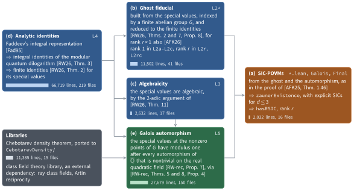

# SIC-POVMs exist in every dimension: a Lean 4 formalization

This repository contains a complete, machine-checked proof in Lean 4 that **symmetric informationally complete POVMs (SIC-POVMs) exist in every finite dimension**. This is the existence part of Zauner's conjecture.

- **Statement:** `OpenQuantumProblem23.sicPOVMs` from Google DeepMind's [formal-conjectures](https://github.com/google-deepmind/formal-conjectures) repository, the existence formulation of Open Quantum Problem 23.
- **Also proved:** rank-r SICs exist whenever r ≥ 1, d > 2r + 1 and r(d − r) divides d² − 1 (see [Rank-r SICs](#rank-r-sics)).
- **Mathematics:** the recent proof of Radchenko and Wheeler [RW26, RW-rec], together with a theorem of Appleby, Flammia and Kopp [AFK25].
- **Axioms:** only `propext`, `Classical.choice` and `Quot.sound`.
- **Checks:** six kernels accept the proof (see [Verification](#verification)).
- **Related work:** an earlier, independent Lean 4 formalization by Māris Ozols, [marozols/SIC-existence](https://github.com/marozols/SIC-existence) (public since 9 October 2026), proves the same existence results with its own statements.

## Main theorem

**Theorem.** For every integer d ≥ 1 there exist d² unit vectors ψᵢ in ℂᵈ such that

$$\bigl|\langle \psi_i, \psi_j \rangle\bigr|^2 = \frac{1}{d+1} \qquad \text{for all } i \neq j$$

Such a family is the standard description of a SIC-POVM in dimension d, whose elements are the operators |ψᵢ⟩⟨ψᵢ|/d. It is also the form in which formal-conjectures states the problem. In Lean:

```lean
theorem SICLean.FinalAssembly.zaunerExistence : OpenQuantumProblem23.ZaunerExistence
```

`ZaunerExistence` is our name for the statement of `sicPOVMs`. The definitions it uses are copied verbatim from formal-conjectures. The code block omits their docstrings and the helper `mkStateVector`. `SICLean/Statement.lean` contains them all, and the original file is kept in `vendor/`.

```lean
abbrev StateVector (d : ℕ) := EuclideanSpace ℂ (Fin d)

instance {d : ℕ} : CoeFun (StateVector d) (fun _ => Fin d → ℂ) where
  coe ψ := ψ.ofLp

def IsNormalized {d : ℕ} (ψ : StateVector d) : Prop := ‖ψ‖ = 1

def overlapSq {d : ℕ} (φ ψ : StateVector d) : ℝ :=
  Complex.normSq (∑ i : Fin d, star (φ i) * ψ i)

def HasConstantOverlapSq {d N : ℕ} (c : ℝ) (Φ : Fin N → StateVector d) : Prop :=
  Pairwise fun i j => overlapSq (Φ i) (Φ j) = c

def sicOverlapSq (d : ℕ) : ℝ := (d + 1 : ℝ)⁻¹

def IsSICFamily (d : ℕ) (Φ : Fin (d ^ 2) → StateVector d) : Prop :=
  (∀ i, IsNormalized (Φ i)) ∧ HasConstantOverlapSq (sicOverlapSq d) Φ

def HasSICPOVM (d : ℕ) : Prop :=
  ∃ Φ : Fin (d ^ 2) → StateVector d, IsSICFamily d Φ

-- the statement of sicPOVMs, under our name
def ZaunerExistence : Prop :=
  ∀ d : ℕ, 1 ≤ d → HasSICPOVM d
```

Besides the conjecture `sicPOVMs`, the formal-conjectures file of Open Quantum Problem 23 lists eleven open benchmark cases. Each is a theorem stating that a SIC-POVM exists in one dimension d, for d = 56, 58, 59, 60, 64, 68, 69, 70, 71, 72 and 75. `SICLean/Solution.lean` restates these twelve theorems with the same names and statements and proves them, so that every open statement of the file is settled. `sicPOVMs` follows directly from `zaunerExistence`, and each specific dimension is a one-line special case. The checks below refer to these twelve theorems.

## Rank-r SICs

The formalization also proves an analogue for the rank-r SICs of [AFK25]. For r = 1 they are SIC-POVMs.

**Theorem.** Let r ≥ 1 and d > 2r + 1 be integers such that r(d − r) divides d² − 1. Then there exist d² distinct orthogonal projections Pᵢ of rank r on ℂᵈ and a constant α such that

$$\mathrm{tr}(P_i P_j) = \alpha \qquad \text{for all } i \neq j$$

In Lean, with the definitions of `SICLean/Defs.lean` (docstrings omitted):

```lean
theorem SICLean.FinalAssembly.hasRSIC (d r : ℕ) (hr : 1 ≤ r) (hd : 2 * r + 1 < d)
    (hdiv : r * (d - r) ∣ d ^ 2 - 1) : SICLean.HasRSIC d r

def IsRSIC (d r : ℕ) (P : Fin (d ^ 2) → Matrix (Fin d) (Fin d) ℂ) : Prop :=
  Function.Injective P ∧
  (∀ j, (P j).IsHermitian ∧ P j * P j = P j ∧ (P j).rank = r) ∧
  ∃ α : ℂ, Pairwise fun j k => (P j * P k).trace = α

def HasRSIC (d r : ℕ) : Prop :=
  ∃ P : Fin (d ^ 2) → Matrix (Fin d) (Fin d) ℂ, IsRSIC d r P
```

For r > 1 the proof uses the extension of the twisted convolution identity to all ranks [AFK26].

## Verification

### Results

The checks below were run with Lean `v4.35.0-rc2` on Linux, on commit `7a557d0`. The Lean files of this release differ from that commit only in three comments, and a rebuild of the release reported the same axioms. `VERIFICATION.md` records the environment, the commands and the outputs, and `verification/` contains the scripts.

| Check | What it checks | Result |
|---|---|---|
| `lake build` | `SICLean` and everything it imports compile | success (10339 jobs) |
| `lake env lean CheckAxioms.lean` | the axioms of `zaunerExistence`, `hasRSIC` and the twelve theorems of `SICLean/Solution.lean` | only `propext`, `Classical.choice`, `Quot.sound` |
| `lake comparator --paranoid` | the twelve theorems have exactly the statements in `Challenge.lean`, copied from formal-conjectures, and their proofs are replayed | all six kernels accept |
| `lake check --paranoid` | the environment of the default target, exported as 741,811 declarations including Mathlib | five kernels accept. The sixth, [nanoda](https://github.com/ammkrn/nanoda_lib), runs into its own limits (thread stack size, 31-bit indices) on an environment this large. It accepts an export of all declarations of this project with their dependencies, 151,455 declarations, which contains everything the proofs use. |

With `--paranoid`, both `lake comparator` and `lake check` run six kernels: Lean's kernel in its default and paranoid modes, and the bundled checkers `lean4lean`, `nanoda`, `con-leche` and `con-ron`. The kernels read the declarations from an export, a file that Lean's exporter writes from the compiled project. The exports made here leave out unsafe declarations, which no proof can use. The export of `lake check` also leaves out internal declarations, such as private lemmas, on which no exported declaration depends.

### Trust base

For the main theorem and for `hasRSIC`, a reader needs to trust only:

- their statements above;
- Mathlib's definitions of the notions they use, such as complex Euclidean space and complex matrices;
- the Lean kernel, or one of the independent checkers;
- the three standard axioms.

The intermediate definitions of this project and of its dependencies, for example ray class fields, cannot affect the meaning of the results, whatever they say, because every step is checked by the kernel. `Challenge.lean` is compiled here with `import Mathlib` instead of the utilities of formal-conjectures. A script, `verification/check_challenge.py`, checks by its Git hash that the file kept in `vendor/` is the formal-conjectures file at commit `90d18f6`. It then checks that each declaration of `Challenge.lean`, with its docstring, is a whole declaration of that file, copied verbatim and in order once the attribute lines of the file are removed. It also checks that the theorems of `Challenge.lean` are exactly those that the file marks as open, and that `comparator.json` contains nothing but the two modules, these twelve theorem names, each once, and the three standard axioms.

### Reproducing the checks

We have tested these steps on macOS and Linux.

**Step 1. Install Lean.** Lean is installed with [elan](https://github.com/leanprover/elan), a small tool that manages Lean versions. On macOS or Linux run

```bash
curl https://elan.lean-lang.org/elan-init.sh -sSf | sh
```

and open a new terminal afterwards. The elan page explains the installation on Windows. You do not choose a Lean version yourself: the file `lean-toolchain` of this repository asks for Lean `v4.35.0-rc2`, and elan downloads it the first time a Lean command runs in the repository.

**Step 2. Download this repository.**

```bash
git clone https://github.com/Hertaspace/sic-povm-lean
cd sic-povm-lean
```

**Step 3. Download the compiled Mathlib.**

```bash
lake exe cache get
```

Lake is Lean's build tool and comes with Lean. On first use it downloads the libraries this project depends on, at the versions pinned in `lake-manifest.json`: Mathlib with the libraries it needs, and the class field theory library (see [Dependencies](#dependencies)). The command then downloads Mathlib and the libraries it builds on in compiled form, so that they do not have to be compiled on your machine. Because this is the first Lean command in the repository, elan first downloads Lean itself, about half a gigabyte, and may show a single line for several minutes.

**Step 4. Check the proof.**

```bash
lake build
```

This compiles `SICLean` together with the Chebotarev files in `CebotarevDensity/` and about 950 modules of the class field theory library. Compiling a Lean file means checking it: Lean's kernel verifies every proof, and the build fails if any proof does not check. None of these files is downloaded in compiled form, so all their proofs are checked again on your machine. On a MacBook Pro with an Apple M5 Max this took about 20 minutes. A successful build ends with a line that begins with `Build completed successfully`. Along the way it prints about 1,900 warnings, for example about deprecated names, and the output of the `#check` and `#print axioms` commands in many files. These are expected.

Mathlib and the libraries it builds on are not compiled here, because step 3 downloaded them already compiled. To check them as well, start from a fresh clone, skip step 3 and run `LAKE_NO_CACHE=1 LAKE_ARTIFACT_CACHE=false lake build`, which compiles them from source and takes much longer. Step 7 also replays them.

**Step 5. See which axioms the proofs use.**

```bash
lake env lean CheckAxioms.lean
```

`lake env` runs a command inside the project, so that Lean finds the compiled files. `CheckAxioms.lean` prints the definition of `ZaunerExistence` and then, for `zaunerExistence`, `hasRSIC` and each of the [twelve theorems](#main-theorem) of `SICLean/Solution.lean`, the axioms that its proof depends on. Each of these lines should read like

```
'SICLean.FinalAssembly.zaunerExistence' depends on axioms: [propext, Classical.choice, Quot.sound]
```

These are Lean's three standard axioms. A proof left incomplete with `sorry` would also list `sorryAx`, and any further axiom that a proof relies on would appear in the list as well. Hypotheses of a theorem are not axioms: they are part of its statement, given above.

**Step 6 (optional). Check the copy of the statements.**

```bash
python3 verification/check_challenge.py
```

This needs only Python 3.8 or later. It checks that `Challenge.lean` copies the twelve open statements of formal-conjectures verbatim and that `comparator.json` names each of them once (see [Trust base](#trust-base)). It prints a line that begins with `21 declarations of Challenge.lean`.

**Step 7 (optional, Linux only). Replay the proofs in other checkers.** Steps 4 and 5 rely on Lean's own kernel. Lean `v4.35.0-rc2` also ships tools that replay proofs through further checkers, among them `lean4lean` and `nanoda`, which are independent implementations of Lean's type checker. They run in a sandbox made with `bubblewrap`, which is available on Linux. Install it first, for example with `sudo apt-get install bubblewrap` on Debian or Ubuntu, and make sure that `bwrap` is on your PATH. The system must allow unprivileged user namespaces, or `bwrap` must be installed setuid root, as some distributions do. `VERIFICATION.md` describes the adjustment we needed in our container.

```bash
lake comparator --paranoid     # judges SICLean.Solution against Challenge, see comparator.json
lake check --paranoid          # exports the default target and replays it through all bundled checkers
```

- `lake comparator` checks that the twelve theorems of `SICLean/Solution.lean` have exactly the statements in `Challenge.lean` and use only the three standard axioms, and it replays their proofs through six kernels. A successful run ends with `Your solution is okay!`. In our run it took 1 h 23 min and at most 8.6 GB of memory, and it kept about two cores busy on average.
- `Challenge.lean` contains the twelve statements with `sorry` in place of the proofs, copied from formal-conjectures. It is the only compiled file with `sorry`, it is not a default build target, and it exists only for `lake comparator`.
- `lake check` exports the environment of the build, 741,811 declarations including Mathlib, and replays the export through the same six kernels. In our run it took 5 h 10 min and at most 56 GB of memory, again with about two cores busy on average. nanoda stops on an environment this large (see [Results](#results)), and `VERIFICATION.md` gives the commands we used to run nanoda on an export of this project instead.

## Proof outline



In the figure, the label at the top right of a part names the files or directories of `SICLean/` that contain it, and an arrow points from a part to the parts that use its results. Bars show lines of Lean code, not counting blank lines and comments, as counted by tokei 14.0.0. `SICLean/` has 443 files and 110,564 lines of code.

The proof has five parts.

| Part | Content | Source | Lean code |
|---|---|---|---|
| (a) | A SIC-POVM is obtained from a "ghost" fiducial and a field automorphism under which its nontrivial overlaps acquire the modulus required of a SIC. | proof of [AFK25, Thm. 1.46] | `SICLean/*.lean`, `SICLean/Galois`, `SICLean/Final` |
| (b) | The ghost is built from special values of the modular quantum dilogarithm, indexed by the points of a finite abelian group G, with the modular parameter at the attracting fixed point of a hyperbolic matrix, using finite identities. | [RW26, Thms. 2 and 7, Prop. 8], for r > 1 also [AFK26] | `SICLean/L2*`, and `SICLean/L4` for the special values |
| (c) | The special values are algebraic numbers, by a 2-adic argument. | [RW26, Thm. 11] | `SICLean/L3` |
| (d) | The analytic properties of the modular quantum dilogarithm, including its integral identities, are derived from the integral representation of Faddeev's quantum dilogarithm. | [RW26, Thm. 3], [Fad95] | `SICLean/L4` |
| (e) | The automorphism is supplied by [RW-rec, Prop. 7]: the special values at the nonzero points of G have modulus one after every automorphism of the field of algebraic numbers that acts nontrivially on the real quadratic field. The proof uses unit properties at odd primes and Frobenius congruences at split primes, together with ray class fields, Artin reciprocity and the Chebotarev density theorem. These place the special values divided by the value at zero in a narrow ray class field and determine the Artin action needed there. | [RW-rec, Prop. 7], using [RW-rec, Thms. 5 and 8, Prop. 4] | `SICLean/L5` |

## Repository layout

| Path | Content |
|---|---|
| `SICLean.lean` | root module, with an overview of the layers |
| `SICLean/Statement.lean` | the target statement, verbatim from formal-conjectures |
| `SICLean/*.lean` | from ghost SICs with a unimodular Galois flip to SICs [AFK25], including rank r |
| `SICLean/Galois` | the algebraic closure, embeddings and the statement of [RW-rec, Prop. 7] used by the reduction |
| `SICLean/L2*` | reduction to the finite identities of [RW26] (Theorems 2 and 7, Proposition 8), for rank r > 1 following [AFK26] |
| `SICLean/L3` | algebraicity of the special values [RW26, Thm. 11] |
| `SICLean/L4` | analytic properties of the modular quantum dilogarithm [RW26, §§2–3] |
| `SICLean/L5` | [RW-rec, Prop. 7] via ray class fields, Artin reciprocity and the Chebotarev density theorem |
| `SICLean/Final`, `SICLean/L5/ActualProp7.lean` | final assembly: `zaunerExistence` and `hasRSIC` |
| `SICLean/Solution.lean` | the formal-conjectures statements, proved |
| `Challenge.lean`, `comparator.json` | the formal-conjectures statements with `sorry`, for `lake comparator` |
| `CheckAxioms.lean` | prints the definition of the statement and the axioms used by `zaunerExistence`, `hasRSIC` and the twelve theorems of `SICLean/Solution.lean` |
| `VERIFICATION.md`, `verification/` | the record of the release checks and the scripts they used |
| `CebotarevDensity/`, `CebotarevDensity.lean` | Chebotarev density theorem, vendored and ported (see `CebotarevDensity/PROVENANCE.md` and `LICENSE`) |
| `docs/` | the figure in this README and its LaTeX source |
| `vendor/` | the original formal-conjectures file for Open Quantum Problem 23 (not compiled) |

Notes:

- In `SICLean/L4`, files `G1*` prove the integral identities (22) and (23) of [RW26, Thm. 3]. Files `G2*` derive from them the finite identities (6) and (7) of [RW26, Thm. 2] by contour shifts and residues. Files `M74*`, `M75*` and `M78*` show that the actual special values satisfy the finite system of `SICLean/L3`. Statements in the `G1*` files carry file-local labels such as `R05`.
- Theorems in intermediate files may carry explicit hypotheses, for example the inputs in `SICLean/Inputs.lean`. The final assembly proves all of these inputs. `zaunerExistence` therefore has no hypotheses, and `hasRSIC` has only the conditions on d and r stated above.
- Many files end with `#check` and `#print axioms` commands that record the API and axioms used. They add no declarations, and `lake build` prints their output.
- Bracketed references in comments point to the part of a source that a declaration formalizes or supports. Auxiliary lemmas cite the surrounding argument.
- The Open Quantum Problems page linked in the file in `vendor/` returned an HTTP 500 error in October 2026. The same problem, with the same three formulations, is Problem 23 of [arXiv:quant-ph/0504166](https://arxiv.org/abs/quant-ph/0504166).

## Dependencies

| Dependency | Version | Used for | How it is included |
|---|---|---|---|
| Lean | `v4.35.0-rc2` | proof assistant and kernel | `lean-toolchain` |
| [Mathlib](https://github.com/leanprover-community/mathlib4) | `0653561` | mathematical library | pinned in `lake-manifest.json` |
| [n-yamaguchi-0729/ClassFieldTheory](https://github.com/n-yamaguchi-0729/ClassFieldTheory) (Apache-2.0) | `fbd320c` | ray class fields and Artin reciprocity | pinned in `lake-manifest.json` |
| [CBirkbeck/chebotarev-density](https://github.com/CBirkbeck/chebotarev-density) (Apache-2.0) | `8575c9d` | Chebotarev density theorem | ported and vendored in `CebotarevDensity/`, see `PROVENANCE.md` |

- Lean `v4.35.0-rc2` and Mathlib `0653561` are the versions pinned by the class field theory library.
- A fork of the class field theory library at the same commit, tagged `sic-povm-pin`, is kept at [Hertaspace/ClassFieldTheory](https://github.com/Hertaspace/ClassFieldTheory) in case the original repository becomes unavailable.

## Mathematical sources

- [RW26] D. Radchenko, C. Wheeler, *Real quadratic fields and finite quantum dilogarithms I*, [arXiv:2609.21892v2](https://arxiv.org/abs/2609.21892v2).
- [RW-rec] *Stark units for real quadratic fields and reciprocity laws*, 4 October 2026, <https://www.danrad.net/papers/stark-reciprocity.pdf> (accessed October 2026).
- [AFK25] M. Appleby, S. T. Flammia, G. S. Kopp, *A constructive approach to Zauner's conjecture via the Stark conjectures*, [arXiv:2501.03970](https://arxiv.org/abs/2501.03970).
- [AFK26] M. Appleby, S. T. Flammia, G. S. Kopp, *The twisted convolution identity and ghost r-SICs from finite quantum dilogarithms*, [arXiv:2609.39192](https://arxiv.org/abs/2609.39192).
- [Fad95] L. D. Faddeev, *Discrete Heisenberg–Weyl group and modular group*, Lett. Math. Phys. 34 (1995), 249–254, [arXiv:hep-th/9504111](https://arxiv.org/abs/hep-th/9504111).

The mathematics is due to these authors. The formalization follows their proof but, as usual for a formalization, is not a line-by-line transcription. Many steps are spelled out in more detail than in the papers. Results from the literature that the papers use are proved here or taken from other Lean libraries, and some arguments are arranged differently to suit Lean.

## How this formalization was produced

The Lean code was written under human direction by large language model agents. The work relied on collaboration and cross-checking between agents from different providers. None of this affects the trust base described above.

## License

Apache License 2.0 (see `LICENSE`). Third-party material keeps its own notices:

- `CebotarevDensity/` and `CebotarevDensity.lean` (Apache-2.0, see `CebotarevDensity/LICENSE` and `PROVENANCE.md`);
- the material from google-deepmind/formal-conjectures (Apache-2.0) in `vendor/formal-conjectures-OQP23.lean`, `SICLean/Statement.lean`, `Challenge.lean` and `SICLean/LowDim.lean`.

## Citation

```bibtex
@misc{yang2026sicpovmlean,
  author       = {Yang, Yaoling},
  title        = {{SIC-POVMs} exist in every dimension: a {Lean} 4 formalization},
  year         = {2026},
  howpublished = {GitHub repository},
  url          = {https://github.com/Hertaspace/sic-povm-lean},
  note         = {Release v1.0}
}
```
